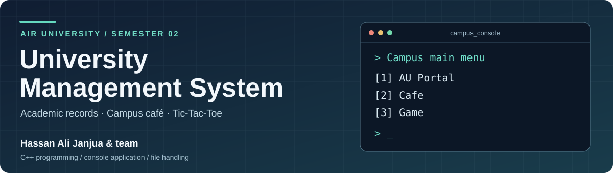
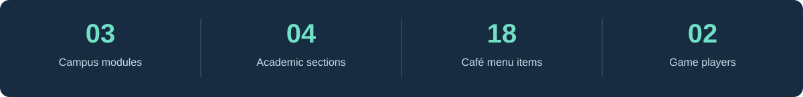
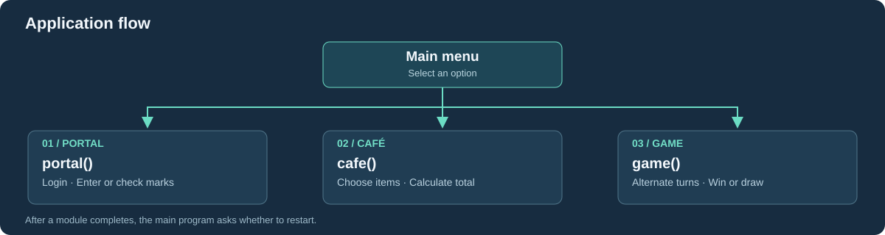
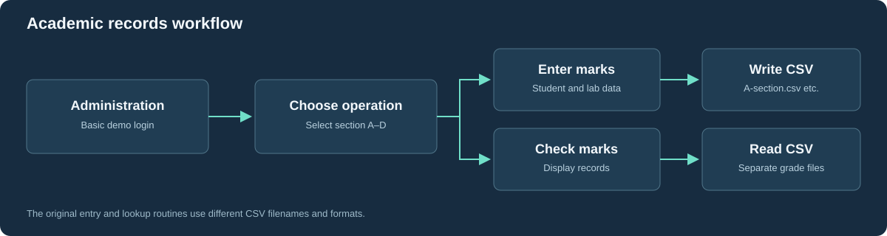
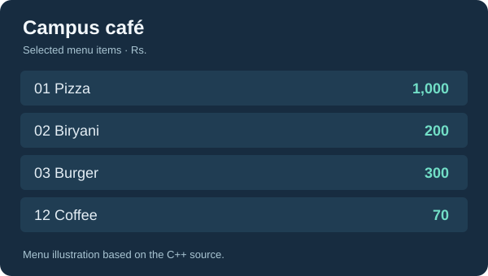
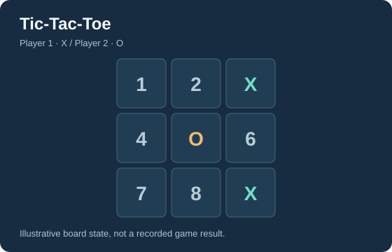

<div align="center">




**Hassan Ali Janjua · Mechatronics Engineering · Air University, Islamabad**

[Project overview](#the-idea-behind-this-project) · [Academic portal](#academic-portal) · [Café](#campus-cafe) · [Game](#tic-tac-toe) · [Getting started](#getting-started)

</div>



## The idea behind this project

This was one of my early programming projects during the second semester of my engineering degree. My teammates and I wanted to take the C++ concepts we were learning and apply them to something familiar — our own university.

Instead of building a single-purpose program, we combined three everyday campus activities into one console application: managing academic marks, ordering food from the university café and playing a quick game of Tic-Tac-Toe.

It was a practical introduction to breaking a problem into functions, handling user input, working with files and connecting multiple features through a menu.

## How the application works



The main menu routes the user to the selected module. Each module has its own functions, and the program offers the option to return to the main menu afterwards.

<details>
<summary><b>Explore the main menu logic</b></summary>

```cpp
switch (decide)
{
    case 1:
        portal();
        break;
    case 2:
        cafe();
        break;
    case 3:
        game();
        break;
    default:
        cout << "Invalid input\n";
}
```

[View main function in the source](University%20Management%20System.cpp#L33-L64)

</details>

---

<a name="academic-portal"></a>

## 01 / Academic portal

The academic portal was the most substantial part of the project. We divided student records into four sections, A through D, and implemented a basic administration login followed by options to enter or display marks.

<table>
<tr>
<td width="52%" valign="top">

<b>Marks entry</b>

<br><br>
Student roll number and name<br>
Lab performance and lab reports<br>
Midterm, final and project marks<br>
Section-wise CSV export

</td>
<td width="48%" valign="top">

<b>Marks lookup</b>

<br><br>
Choose section A, B, C or D<br>
Read the relevant CSV file<br>
Parse records using file and string streams<br>
Display marks in the console

</td>
</tr>
</table>



We used arrays, loops, file streams and formatted console output to handle student information. Some marks are generated using random numbers in the coursework program; these are simulated values rather than real student results.

<details>
<summary><b>CSV file mapping and implementation details</b></summary>

| Section | Marks entry writes | Marks lookup expects |
| --- | --- | --- |
| A | `A-section.csv` | `MTSA-CP-GRADES.csv` |
| B | `B-section.csv` | `MTSB-CP-GRADES.csv` |
| C | `C-section.csv` | `BEBME-OOP-GRADES.csv` |
| D | `D-section.csv` | `POWER-CP.csv` |

The entry and lookup files have different names and record formats in the original implementation. The lookup datasets are not included in this repository. I have kept the coursework source as it was, so these two operations should not be treated as a verified round-trip database workflow.

[Portal menu](University%20Management%20System.cpp#L68-L179) · [Marks entry functions](University%20Management%20System.cpp#L186-L933) · [Marks lookup functions](University%20Management%20System.cpp#L934-L1190)

</details>

<a name="campus-cafe"></a>

## 02 / Campus café

For the café, we wanted to simulate a simple food-ordering experience. The user chooses from 18 menu items, can select additional items and receives the total bill at the end of the session.

<table>
<tr>
<td width="52%" align="center">

<br><sub>Selected items from the original menu — design illustration</sub>
</td>
<td width="48%" valign="top">

<b>Ordering workflow</b>

<br><br>
01 — Display the available items<br>
02 — Select an item<br>
03 — Add its price to the total<br>
04 — Continue ordering or finish<br>
05 — Display the final bill in rupees

<br><br>
<a href="University%20Management%20System.cpp#L1196-L1321">Explore café implementation →</a>

</td>
</tr>
</table>

This module helped me understand conditional logic, repeated input and keeping a running total.

<a name="tic-tac-toe"></a>

## 03 / Tic-Tac-Toe

We added a two-player game as a lighter part of the campus application. Players take turns selecting positions on a 3 × 3 board. The program checks rows, columns and diagonals to determine the winner or a draw.

<table>
<tr>
<td width="46%" align="center"><br><sub>Board layout and example moves</sub></td>
<td width="54%" valign="top">

<b>Game logic</b>

<br><br>
Two players: X and O<br>
Numbered positions from 1 to 9<br>
Alternating turns<br>
Occupied-cell checks<br>
Win and draw detection

<br><br>
<a href="University%20Management%20System.cpp#L1328-L1445">Explore game implementation →</a>

</td>
</tr>
</table>

## What I learned

Working on these three modules gave me experience with the fundamentals of C++ in a practical setting.

| Programming concept | How we applied it |
| --- | --- |
| Functions and control flow | Separate portal, café and game modules |
| Arrays and indexing | Student marks and the 3 × 3 game board |
| File handling | Section-wise CSV records |
| String streams | Reading comma-separated values |
| Loops and conditionals | Menus, repeated orders and turn-based play |
| Formatted output | Console tables, prompts and billing |

Looking back, I would structure the data around reusable types, improve input validation and make the CSV reader and writer use a consistent schema. This project was an early step in learning how to turn programming concepts into a complete application.

## Getting started

The original source is available here: [University Management System.cpp](University%20Management%20System.cpp).

Clone the repository:

```bash
git clone https://github.com/HassanAliJanjua03/University-Mangement-System.git
cd University-Mangement-System
```

The original program uses variable-length arrays, a GNU C++ extension. Try a GNU-compatible compiler such as GCC/MinGW:

```bash
g++ -std=gnu++17 -Wall -Wextra "University Management System.cpp" -o university
```

On Linux/macOS, launch with `./university`; on Windows with MinGW, launch `.\university.exe` (or explicitly compile with `-o university.exe`).

The original code has not been build- or runtime-verified for this update. See the [implementation notes](docs/implementation.md) for known issues and a safe way to explore the program. Use only fictional student records. The project is coursework, not an official university system or a production database.

## Repository structure

```text
University-Mangement-System/
├── University Management System.cpp
├── assets/
│   ├── cover.svg
│   ├── modules.svg
│   ├── program-flow.svg
│   ├── portal-flow.svg
│   ├── cafe-menu.svg
│   └── game-board.svg
├── docs/
│   └── implementation.md
├── .gitignore
└── README.md
```

The graphics are illustrations based on the source, not screenshots of a verified program run.

---

<div align="center">

**Second-semester group project · Air University**

Hassan Ali Janjua · M Shehroz Khan · Ali Torab

[My engineering portfolio](https://github.com/HassanAliJanjua03)

</div>
